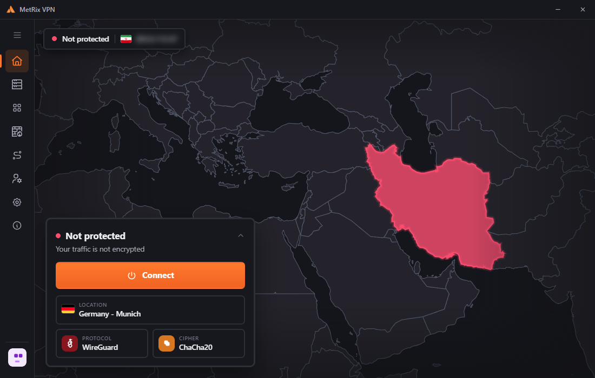
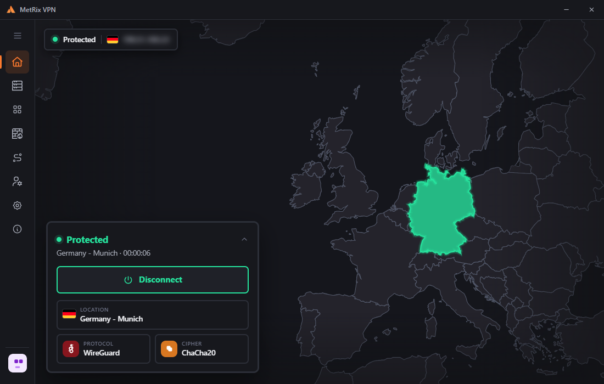

  

<h1 align="center">MetRix VPN for Windows</h1>

  A fast, private VPN for Windows - modern tunnels, a kill switch and built-in ad &amp; tracker blocking, in one clean app. 
  <b>Version 1.0.0 (build 10)</b>

  <a href="../../releases/latest"><b>Download the installer</b></a>

<table align="center">
  <tr>
    <td align="center"></td>
    <td align="center"></td>
  </tr>
</table>

## What is MetRix VPN?

MetRix VPN is the Windows version of the MetRix VPN mobile app. It uses the same account, so your plan, devices and
login follow you between your phone and your PC. Sign in with your email, or with a one-time **Login Code** generated in the phone app.

## Features

- **Several tunnel protocols** - WireGuard, HyperFlow, SecLink and OpenVPN (UDP / TCP), chosen per connection.
- **Locations in dozens of countries**, with a live signal bar for each one and favourites.
- **Kill switch** - blocks all traffic if the VPN drops, and restores the connection automatically.
- **NetGuard** - account-wide blocking of ads, trackers, malware, crypto miners and more, with live statistics.
- **Live map** - your country in red while unprotected, the exit country in green once connected.
- **Real-time speed graph**, connection timer and your public IP at a glance.
- **Light, dark and system theme**, a compact docked mode, and a collapsible icon menu.
- **Automatic updates** from this page - stable releases by default, beta builds if you opt in.
- **One account everywhere** - Free and Pro plans, device list and usage in the Account page.

## Install

1. Download the installer for your PC from the [latest release](../../releases/latest):
   - **MetRix-VPN-Setup-1.0.0-x64.exe** - 64-bit Windows (most PCs)
   - **MetRix-VPN-Setup-1.0.0-ia32.exe** - 32-bit Windows
2. Run it and accept the administrator prompt once (the VPN needs a small background service to create network adapters).
3. Open MetRix VPN, sign in, pick a location and press **Connect**.

**Requirements:** Windows 10 or 11 (64-bit or 32-bit). Not sure which one you have? Open *Settings - System - About* and look at *System type*.

> The 32-bit edition has no OpenVPN engine: OpenVPN UDP locations connect with WireGuard instead. Everything else is identical.

## Updates

MetRix VPN checks this repository for new versions and offers them in **About**. You can also turn on **Beta updates** there to get test builds early.

## Support

Questions or problems? Open **About - Copy diagnostics** in the app and send it to us on Telegram: [@MetrixVPN_Support](https://t.me/MetrixVPN_Support).

---

MetRix VPN for Windows. All rights reserved. Third-party components: AmneziaWG, Xray, OpenVPN and Wintun, each under its own licence.
